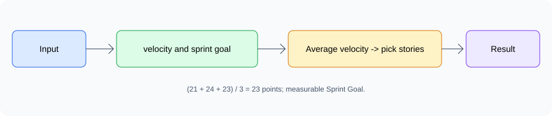

# Question 1 – Velocity and sprint goal

**Question:** Calculate the average velocity, select stories from a supplied backlog to match it, and write a measurable Sprint Goal.

### Average velocity

(21 + 24 + 23) / 3 = 68 / 3 = **22.7 ≈ 23 story points**

### Stories selected (top of the ordered backlog until ~23 points)

| ID | Story | Points |
|---|---|---|
| WAL-101 | Add money by UPI | 5 |
| WAL-102 | Send money by phone number | 8 |
| WAL-103 | Transaction history with filters | 3 |
| WAL-104 | Set / change wallet PIN | 3 |
| WAL-107 | Rs.50 cashback on first payment | 2 |
| WAL-108 | Dark mode | 2 |
| **Total** | | **23** |

WAL-105 (KYC, 8) would take the sprint to 31, far above our velocity, so it stays in the product backlog.

### Sprint Goal

> **"A new user can top up the wallet by UPI and send money to another user by phone number, protected by a PIN, and see
> both transactions in the history."**
>
> Measured by: the end-to-end flow (top-up → PIN → transfer → history) passes on the staging environment for 20 test
> users, with 95% of transfers confirmed within 5 seconds.

## Files in this folder

- [flowchart.svg](flowchart.svg)
- [product_backlog.md](product_backlog.md)

## Approach

