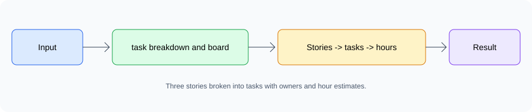

# Question 2 – Task breakdown and board

**Question:** Break three selected stories into tasks with hour estimates and record them on the sprint board.

### Task breakdown (hours)

| Story | Task | Owner | Est. (h) |
|---|---|---|---|
| WAL-101 Add money by UPI (5) | Top-up screen and amount validation | Priya (mobile) | 6 |
| | UPI collect request API integration | Karthik (backend) | 8 |
| | Webhook to credit wallet on payment success | Karthik | 6 |
| | Unit + integration tests, failure cases | Meena (QA) | 6 |
| WAL-102 Send money (8) | Contact picker and recipient lookup by phone | Priya | 8 |
| | Transfer API with balance check and idempotency key | Rahul (backend) | 10 |
| | Ledger entries for debit / credit | Rahul | 6 |
| | Push notification to receiver | Arun (mobile) | 4 |
| | Test cases incl. insufficient balance, unknown number | Meena | 8 |
| WAL-104 Wallet PIN (3) | PIN set / change screens | Arun | 5 |
| | PIN hashing and 3-attempt lockout API | Karthik | 5 |
| | Security tests | Meena | 4 |

### Sprint board (end of day 3)

| To Do | In Progress | Done |
|---|---|---|
| WAL-102 Push notification (Arun) | WAL-101 Webhook to credit wallet (Karthik) | WAL-101 Top-up screen (Priya) |
| WAL-102 Ledger entries (Rahul) | WAL-102 Transfer API (Rahul) | WAL-101 UPI collect integration (Karthik) |
| WAL-102 Test cases (Meena) | WAL-102 Contact picker (Priya) | WAL-104 PIN screens (Arun) |
| WAL-104 Security tests (Meena) | WAL-101 Tests (Meena) | |
| WAL-104 PIN lockout API (Karthik) | | |
| WAL-103, WAL-107, WAL-108 (not yet broken down) | | |

## Files in this folder

- [flowchart.svg](flowchart.svg)

## Approach

