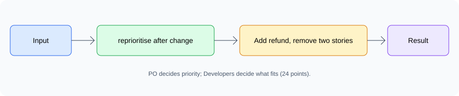

# Question 4 – Reprioritise after change

**Question:** Re-prioritise the backlog after the refund-to-wallet request: state what is added, what is removed and who decides.

### Refund-to-wallet request (day 4)

New story from the business: **WAL-111 – As a user I want a failed or cancelled merchant payment refunded to my wallet
so that I get my money back instantly – 5 points.**

| | |
|---|---|
| Who decides | The **Product Owner** decides whether it is more valuable than the remaining work and re-orders the backlog. The **Developers** decide how much work fits in the sprint. The Scrum Master facilitates; the business sponsor cannot add it directly. |
| Does it fit the Sprint Goal? | Yes – it uses the same ledger and history built for WAL-101/102, so it supports the goal instead of replacing it. |
| Added | WAL-111 Refund to wallet (5) |
| Removed (back to the product backlog) | WAL-107 Cashback on first payment (2) and WAL-108 Dark mode (2) – not started, not part of the goal |
| New sprint scope | 23 − 4 + 5 = **24 points** (inside the 21–24 range of past velocities) |
| Sprint Goal | Unchanged; one line added to the measure: "a refund appears in history within 1 minute". |

If the refund had needed new integrations (e.g. a new bank API), the PO would have put it at the top of the next sprint
instead of changing this one.

## Files in this folder

- [flowchart.svg](flowchart.svg)

## Approach

