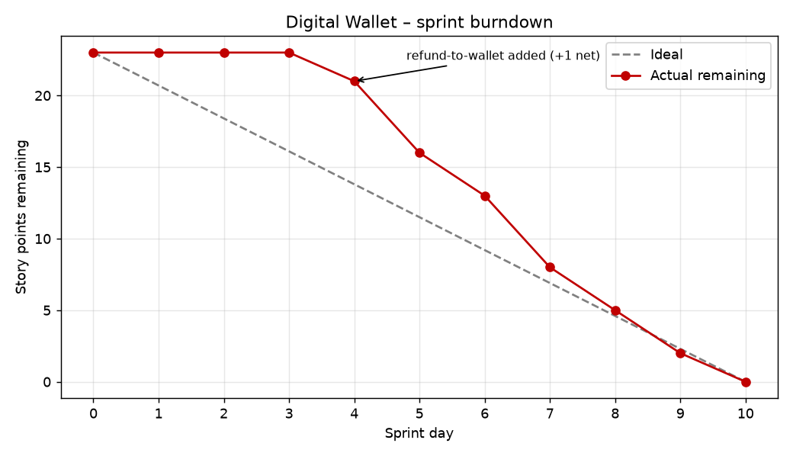

# Burndown chart

**Question:** Prepare a sprint burndown for 10 days from a supplied completed-points table and interpret the trend.

### Burndown (10 days)

Scope: 23 points, 24 from day 4 (refund-to-wallet added, two small stories removed).

| Day | 0 | 1 | 2 | 3 | 4 | 5 | 6 | 7 | 8 | 9 | 10 |
|---|---|---|---|---|---|---|---|---|---|---|---|
| Completed that day | – | 0 | 0 | 0 | 3 | 5 | 3 | 5 | 3 | 3 | 2 |
| Remaining | 23 | 23 | 23 | 23 | 21 | 16 | 13 | 8 | 5 | 2 | 0 |
| Ideal | 23.0 | 20.7 | 18.4 | 16.1 | 13.8 | 11.5 | 9.2 | 6.9 | 4.6 | 2.3 | 0.0 |

**Interpretation:** the line stays flat on days 1–3 because stories only count when Done and the UPI sandbox limit slowed testing – the team is above the ideal line. On day 4 the scope grows by 1 point (refund-to-wallet in, two small stories out), which hides part of that day's progress. From day 4 the team closes stories steadily, and by day 8 it is back on the ideal line. All 24 points are done on day 10. Lesson: break stories into smaller pieces so they reach Done earlier, which avoids the flat start.
