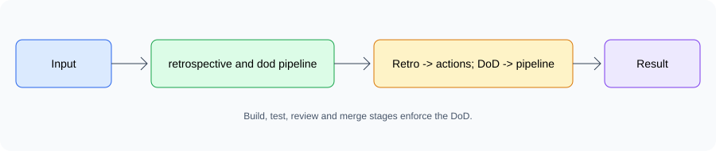

# Question 6 – Retrospective and dod pipeline

**Question:** Write the retrospective (what went well, what to improve, two action items with owners) and map the Definition of Done to a build pipeline (build, test, review, merge).

### Retrospective

| What went well | What to improve |
|---|---|
| Refund-to-wallet was absorbed without missing the Sprint Goal | Stories were Done late – flat burndown for 3 days |
| Pairing backend + QA on the webhook found 4 bugs before review | Sandbox limits and certificates were discovered only when they blocked us |
| Stand-ups stayed within 15 minutes | Pull requests waited up to a day for review |

**Action items**

| # | Action | Owner | Due |
|---|---|---|---|
| 1 | Split any story above 5 points into slices that can be Done within 3 days | Anitha (SM) with the team, in refinement | Next sprint planning |
| 2 | Add a "third-party readiness" check (sandbox quota, certificates, test data) to the Definition of Ready | Karthik | Before next sprint planning |
| 3 | Review pull requests within 4 working hours (shown on the board) | Rahul | From day 1 of next sprint |

### Definition of Done mapped to the build pipeline

| DoD item | Pipeline stage | How it is checked |
|---|---|---|
| Code compiles and the app builds | **Build** | CI builds the Android/iOS app and backend container on every push |
| Unit tests pass, coverage of new code ≥ 80% | **Test** | Unit test job; coverage gate fails the build below 80% |
| API and acceptance tests pass | **Test** | Integration tests against the UPI sandbox on staging |
| No high security issues | **Test** | Dependency and static security scan |
| Code reviewed by at least one other developer | **Review** | Pull request needs 1 approval; checks must be green |
| Merged to main and deployed to staging | **Merge** | Branch protection allows merge only after review + green pipeline; merge triggers staging deploy |
| PO accepted | After merge | Demo on staging in the sprint review |

So a story cannot be "Done" unless it has passed every pipeline stage – the pipeline enforces most of the DoD
automatically, and only PO acceptance stays manual.

```yaml
# .github/workflows/wallet-ci.yml (simplified)
on: [pull_request, push]
jobs:
  build-test:
    runs-on: ubuntu-latest
    steps:
      - uses: actions/checkout@v4
      - run: ./gradlew assembleDebug            # build
      - run: ./gradlew test jacocoTestReport    # unit tests + coverage
      - run: ./scripts/coverage-gate.sh 80      # fail below 80%
      - run: ./scripts/security-scan.sh         # dependency / SAST scan
```


## Files in this folder

- [flowchart.svg](flowchart.svg)

## Approach


