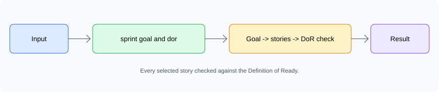

# Question 2 – Sprint goal and dor

**Question:** Write the Sprint Goal and select stories; document the Definition of Ready check for each selected story.

### Sprint Goal

> **"A passenger can check in online for a domestic flight, choose a free seat and get a boarding pass on their phone;
> paid seat upgrades work end-to-end with the payment gateway."**

### Selected stories (24 points)

| ID | Story | Points |
|---|---|---|
| CHK-201 | Check in with PNR and last name | 5 |
| CHK-202 | Choose a free seat on the seat map | 5 |
| CHK-203 | Paid seat upgrade (extra legroom) via payment gateway | 8 |
| CHK-204 | Mobile boarding pass with QR code | 3 |
| CHK-205 | Add a frequent-flyer number at check-in | 3 |
| *Stretch* CHK-206 | Email boarding pass as PDF | 3 |

### Definition of Ready check

| DoR item | 201 | 202 | 203 | 204 | 205 |
|---|---|---|---|---|---|
| User story format with clear value | ✔ | ✔ | ✔ | ✔ | ✔ |
| Acceptance criteria in Given / When / Then | ✔ | ✔ | ✔ | ✔ | ✔ |
| Estimated by the team | ✔ | ✔ | ✔ | ✔ | ✔ |
| ≤ 8 points | ✔ | ✔ | ✔ | ✔ | ✔ |
| UX design attached | ✔ | ✔ | ✔ | ✔ | n/a |
| External dependencies available | DCS API ✔ | Seat-map API ✔ | Payment sandbox ✔ (checked on planning day) | QR library ✔ | Loyalty API ✔ |
| Test data available | ✔ | ✔ | Test cards ✔ | ✔ | ✔ |

All five stories were Ready. CHK-203 depended on the payment sandbox, which was working at planning.

## Files in this folder

- [flowchart.svg](flowchart.svg)

## Approach

