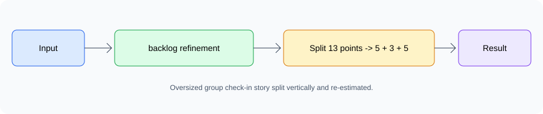

# Question 4 – Backlog refinement

**Question:** Run a refinement session on next sprint's top five stories: split one oversized story and re-estimate.

### Refinement – top five stories for the next sprint

| ID | Story | Before | After refinement |
|---|---|---|---|
| CHK-210 | **Group check-in for a PNR with up to 9 passengers** | 13 | split (below) |
| CHK-211 | Check in for international flights with passport details | 8 | 8 |
| CHK-212 | Select a special meal at check-in | 3 | 2 – reuses existing meal API |
| CHK-213 | Add extra baggage allowance (paid) | 5 | 5 |
| CHK-214 | Show check-in closing time countdown | 2 | 2 |

### Splitting the oversized story (CHK-210, 13 points)

The team split it vertically by passenger type, so each part can be released alone:

| New ID | Story | Points |
|---|---|---|
| CHK-210a | Check in all adult passengers on one PNR together | 5 |
| CHK-210b | Check in an infant travelling on an adult's lap | 3 |
| CHK-210c | Choose seats together for the group on one seat map | 5 |

Re-estimated with Planning Poker: 13 points became 5 + 3 + 5 = 13 in total, but every piece is now ≤ 5 and fits a sprint
with room for others. Top-five backlog after refinement: 210a, 210b, 210c, 211, 213 = 26 points.

## Files in this folder

- [flowchart.svg](flowchart.svg)

## Approach

