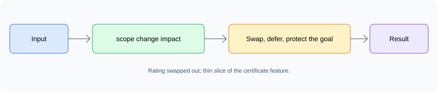

# Question 2 – Scope change impact

**Question:** Analyse the impact of the new request on the sprint: what can be swapped out, what must wait and how the Sprint Goal is protected.

### Impact of the 'certificate download' request on day 6

**Status on day 6:** Done – LRN-301, LRN-302, LRN-306 (15 points). In progress – LRN-304 quiz (8), LRN-303 progress (3).
Not started – LRN-307 rating (3).

| Question | Answer |
|---|---|
| Is it urgent? | Yes – marketing has announced certificates for the launch on day 1 of the next sprint + 2 days. |
| Does it fit the Sprint Goal? | Partly – a certificate needs the quiz result (LRN-304), so it builds on the goal. |
| Size | LRN-309 = 5 points (PDF template, generation service, download button). |
| What can be swapped out | **LRN-307 rating (3)** – not started, not part of the goal – plus **LRN-306** is already done so no gain there. The team can take 3 points out; 2 more points of risk remain. |
| Swap decided | Remove LRN-307 (3). Take a **thinner slice** of LRN-309: "download a certificate with learner name, course and date" (3 points); branded template and verification QR (2 points) go to the next sprint. |
| What must wait | LRN-307 rating, certificate branding and QR verification. |
| How the goal is protected | Quiz and progress (goal stories) stay first in the daily plan; the certificate is only started after the quiz API is done. If the quiz slips, the certificate is dropped, not the quiz. The PO agreed to this order. |

Net change: −3 + 3 = 0 points, sprint stays at 29. The PO made the decision with the Developers; the Scrum Master made
sure the change was discussed openly at the next stand-up and not pushed in silently.

## Files in this folder

- [flowchart.svg](flowchart.svg)

## Approach

