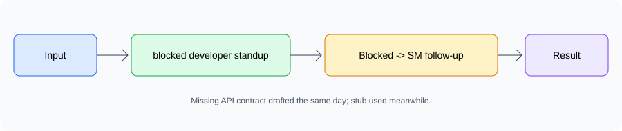

# Question 3 – Blocked developer standup

**Question:** Write the stand-up statements for a developer who is blocked on a missing API contract and the Scrum Master's follow-up action.

### Stand-up – developer blocked on a missing API contract (day 7)

**Sanjay (backend developer):**
- *Yesterday:* finished the quiz grading logic and unit tests.
- *Today:* wanted to connect the certificate generator to the results service.
- *Blocker:* the **results service API contract** (field names, how a "pass" is marked) is not defined by the platform
  team, so I don't know what I will receive. I can't finish LRN-309 without it.

### Scrum Master's follow-up (Nithya)

1. Right after stand-up, Nithya and Sanjay call the platform team lead and agree to **draft the contract together in 1
   hour**: `GET /results/{learnerId}/{courseId}` → `{ score, passed, completedOn }`.
2. The contract is written as an OpenAPI file in the shared repo, so both teams can review it and generate stubs.
3. Sanjay continues with a stub that follows the draft contract, so he is not idle.
4. Nithya adds the item to the impediment log, checks at 4 PM that the platform team has approved the contract, and
   reports at the next stand-up.
5. Retrospective topic: agree API contracts in refinement before a story is Ready.

## Files in this folder

- [flowchart.svg](flowchart.svg)

## Approach

