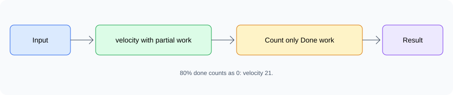

# Question 4 – Velocity with partial work

**Question:** Calculate the velocity for the sprint from a completed-points table where one story is 80 percent done, and explain how partially done work is counted.

### Velocity for the sprint

| Story | Points | Status | Counted |
|---|---|---|---|
| LRN-301 | 8 | Done | 8 |
| LRN-302 | 5 | Done | 5 |
| LRN-303 | 3 | Done | 3 |
| LRN-304 | 8 | 80% done | **0** |
| LRN-306 | 2 | Done | 2 |
| LRN-309 (slice) | 3 | Done | 3 |
| **Velocity** | | | **21** |

**How partially done work is counted:** only stories that meet the Definition of Done count. 80% of LRN-304 is counted as
**0**, not 6.4, because unfinished work has no value to the learner and could still hide problems. LRN-304 goes back to
the product backlog; the team re-estimates the **remaining** work (about 3 points for the grading UI) and the PO orders it
for the next sprint. The original 8 points are not added later, so velocity is not inflated.

The Sprint Goal was **not fully met** (the quiz is not usable), which is discussed in the review and retrospective.

## Files in this folder

- [completed_points.csv](completed_points.csv)
- [flowchart.svg](flowchart.svg)

## Approach

