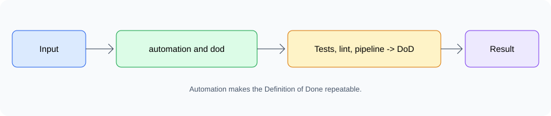

# Question 6 – Automation and dod

**Question:** Explain, in a short note, how automation (unit tests, linting, pipeline) supports the Definition of Done.

### How automation supports the Definition of Done

Our DoD says a story is Done when it is coded, reviewed, tested, meets acceptance criteria and is deployed to staging.
Automation makes these checks fast, repeatable and impossible to skip:

- **Unit tests** check each function (e.g. quiz grading, progress %) on every commit. If a change breaks an earlier
  feature, the test fails in minutes instead of being found in the review. DoD item: "unit tests written and passing".
- **Linting and formatting** (ESLint, Prettier, flake8) catch style issues, unused code and simple bugs before review, so
  reviewers can focus on design. DoD item: "code meets the team's coding standard".
- **CI pipeline** runs build → lint → unit tests → coverage gate → deploy to staging on every pull request. The merge
  button stays disabled until all steps are green and one reviewer has approved. DoD items: "builds", "reviewed",
  "deployed to staging".
- **Automated acceptance tests** (e.g. Playwright scripts for "enrol after payment") check the Given/When/Then
  criteria on staging. DoD item: "acceptance criteria verified".

Because the pipeline enforces most of the DoD, "Done" means the same thing for every story and every developer, and
partially done work such as LRN-304 is visible immediately as a red pipeline.

```yaml
# .github/workflows/elearn-ci.yml (simplified)
on: pull_request
jobs:
  ci:
    runs-on: ubuntu-latest
    steps:
      - uses: actions/checkout@v4
      - run: npm ci
      - run: npm run lint            # linting
      - run: npm test -- --coverage  # unit tests + coverage
      - run: npm run build
      - run: npm run deploy:staging  # only reached if everything above passed
```


## Files in this folder

- [flowchart.svg](flowchart.svg)

## Approach


